# Easy Quizy: how the app evolved (portfolio notes, written in hindsight)

Reconstructed on 2026-10-19 from the git history (22 commits, 19 Sept to 17 Oct 2026), the product spec as it changed,
and the working chats between the author (Taya, a UX designer) and Claude. Dates are commit dates. Where something
was a feeling or a reaction rather than a recorded fact, it says so. **Screenshots exist for one iteration only**
(iteration 2, in `images/`); section 4 says how to get the rest.

## 1. The story in one page

**The problem.** The author is at B1-B2 German. The thing holding her back is vocabulary, and the best-evidenced ways
to build it are active recall and spaced repetition (Anki). Anki feels like admin: you choose decks and levels before you
learn anything.

**The idea.** No decks, no level. You meet one word at a time and **draw a circle round it to say how well you know it**.
That one gesture is both the quiz and the placement test: the app works out where your vocabulary ends, picks words at
the edge of it, schedules the ones you want to learn, and turns your progress into a **map of stars**.

**What the process looked like.** One designer directing, Claude building, in about four weeks and a handful of long
sessions. Every change was tried at once on her own iPhone (Expo Go), then in two small usability tests with friends,
then through TestFlight. The design moved in steps, each triggered by something she saw or someone said.

| # | When | Name | The app after it | What triggered the next step |
|---|---|---|---|---|
| 0 | 19-24 Sep | Concept and spec | A written spec (v0.4), no app | She wanted to try the gesture for real |
| 1 | 19-26 Sep | First playable: the circle | Explore only, 33 words, a red-to-green arc | It felt right, but there was no loop: nothing to do with a word you did not know |
| 2 | 26 Sep | First complete loop | Onboarding test, Study with FSRS, a star-sky Map, dark navy theme, 500 words | The circle looked like every other rating widget; the Map was flat |
| 3 | 30 Sep | The map and the stardust circle | Skia shaders, sphere of dots, tilt, camera mode; the circle drawn in stardust | First friends were about to try it |
| 4 | 10 Oct | Two usability tests, two reworks | New first run, Study as a list plus a test, new "known" moment, a map by meaning | The app worked; the content was thin |
| 5 | 14 Oct | Real words, real structure | 1,474 words from real data, profile, reminders, Explore modes | It needed to leave the laptop |
| 6 | 14-17 Oct | Out the door | App Store Connect, an icon, TestFlight builds 1-5 | Her own list of 16 changes from using it |
| 7 | 17-19 Oct | Design polish round | New welcome and onboarding, cross for "don't know", add your own words, topics merged, selects, one undo place | (this is where the notes stop) |

Numbers over the four weeks: **22 commits; 8 unit tests became 93; 33 words became 500 and then 1,474; the Map ended
at 24 topics after five small ones were merged into the big ones; five TestFlight builds.**

---

## 2. Iterations

### Iteration 0: concept and spec (19-24 Sep)

- **Starting point:** her own pain and a one-paragraph idea in the first message: learn words with the methods that
  work (recall, spaced repetition), but make it "useful, pretty, interesting, exciting".
- **What Claude pushed on** in the first brainstorm, kept in the spec: *Explore* can double as a placement test (so no
  level picker); *Study* only needs to schedule the words you marked as unknown; words that mean nearly the same should
  not be taught back to back (interference); one gesture everywhere.
- **The spec went through four versions (v0.1 to v0.4)** by her annotating it directly. It names the principles that
  survived to today: one gesture, minimal setup, recall over recognition, never overwhelm, words in context but concise.
- **Cost question answered early:** for her alone the app costs nothing; costs start when it is shared (Apple's
  developer programme, build service). This later decided how it was released (see iteration 6).
- **Visual reference hunted:** she liked the "hand-craft, cute" look of an app on Mobbin (One Year) and recorded its
  animations. Mobbin blocked automated access, so references were meant to be sent as screenshots. The direction that
  actually won was different (dark, quiet, astronomical), see iteration 2.
- **Stack decided:** Expo (React Native, TypeScript), iPhone first; Reanimated and Gesture Handler for the circle;
  FSRS for scheduling; all data on the device, no accounts.

### Iteration 1: the first playable (19-26 Sep, commit `c690ccf`)

- **What existed:** only the **Explore** tab. One word in a circle (starting with *der Feierabend*), a ring you drag
  along, an arc that went **red, amber, green**, a snap to a full ring in the last 10%, a ghost finger showing the
  gesture on the first words, a reveal (translation, example, similar words), an undo plate, and "similar word" chips
  to travel by association. Study and Map were placeholders. A light background with dark ink and one orange accent (the palette changed twice in
  the next days).
- **The key interaction rule** that never changed: the arc has four hidden segments (30 / 30 / 30 / 10 per cent) that map
  to the four FSRS grades; a haptic tick marks each boundary; a plain tap does nothing.
- **Checked** in the browser with scripted touch events. Not yet felt on a phone.
- **Learned:** the gesture works and is fun, but a rated word goes nowhere. The app needs a loop.

### Iteration 2: the first complete loop (26 Sep, commits `b2cefa8` to `2c75b2a`)

*Screenshots of this state are in `images/iteration-2-26-sep-first-complete-loop/` (taken from the app in the browser at
iPhone size, with a test profile named Anna).*

- **Content:** the word list grew to **500 words in 24 topics**, each with a **difficulty tier 1-6**, so that the app
  could choose words for you.
- **Onboarding decided with her:** ask only for a name, then **15 words picked adaptively** (a high rating jumps to a
  rarer word, a low one steps back, like a binary search), then straight into a first Study session. Her requirement:
  the person should understand that from now on the words will be "not too easy and not too hard".
- **Study:** a dashboard of word status, a searchable list, sessions that show a word then test it with the circle;
  **FSRS** schedules reviews, seeded by how well you rated the word in Explore. A success haptic and fireworks above 75%.
- **Explore:** pauses when 20 words are waiting to be studied.
- **The Map is born:** a night sky bigger than the screen, one big star per topic, a card per topic with a button to
  explore from there.
- **Visual identity changes twice in a day:** first a cool grey and navy ink, then **a deep navy night everywhere**,
  with a background that **starts empty and gains one small star for every word you rate**. The accent orange was set
  to her exact value `#F75831`.
- **Her feedback that day** (a list she wrote after trying the onboarding on her phone): rewrite the name screen text; the
  button must not touch the keyboard; "let's roll, name" above the first word; the circle must always be in exactly the
  same place and never jump; the new-word card looked messy and its type styles were indistinguishable; make the counter
  smaller and make it show the real count. All were done the same day.
- **Learned:** the circle looked like any progress ring, and the Map was a flat scatter.

Screens (taken in this iteration):

| | | | |
|---|---|---|---|
| 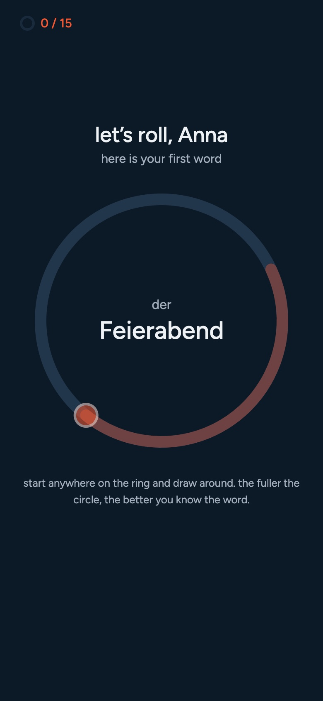 first word, counter 0/15 | 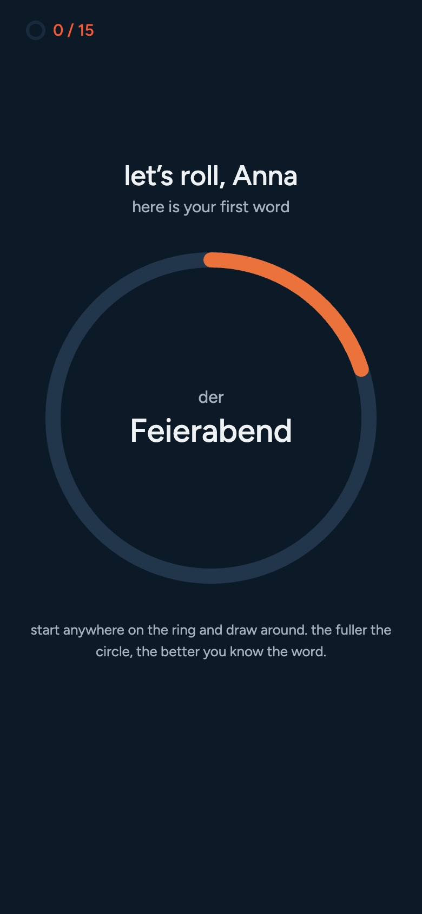 drawing: the arc | 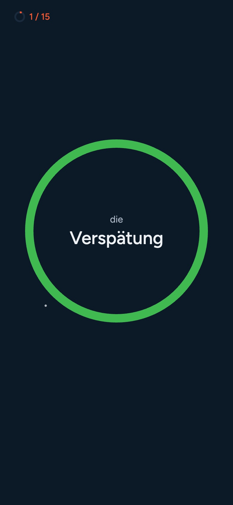 a known word: full green ring | 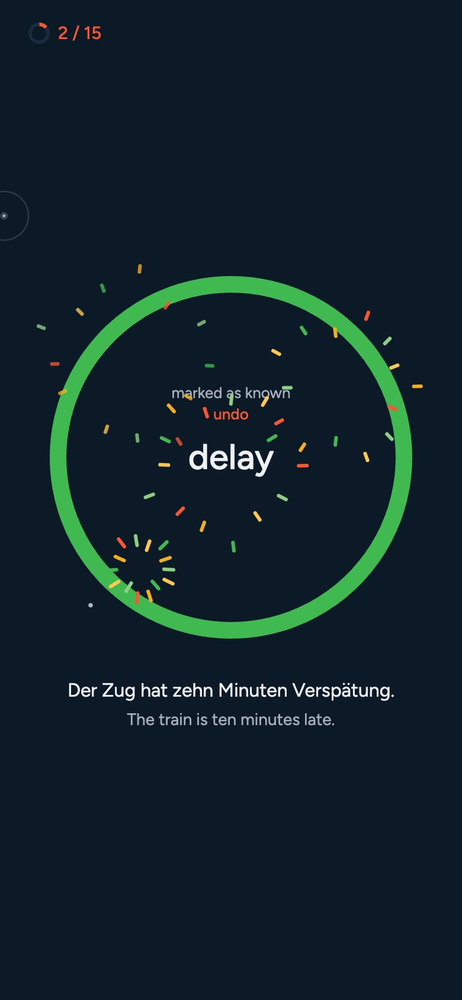 fireworks (later removed) |
| 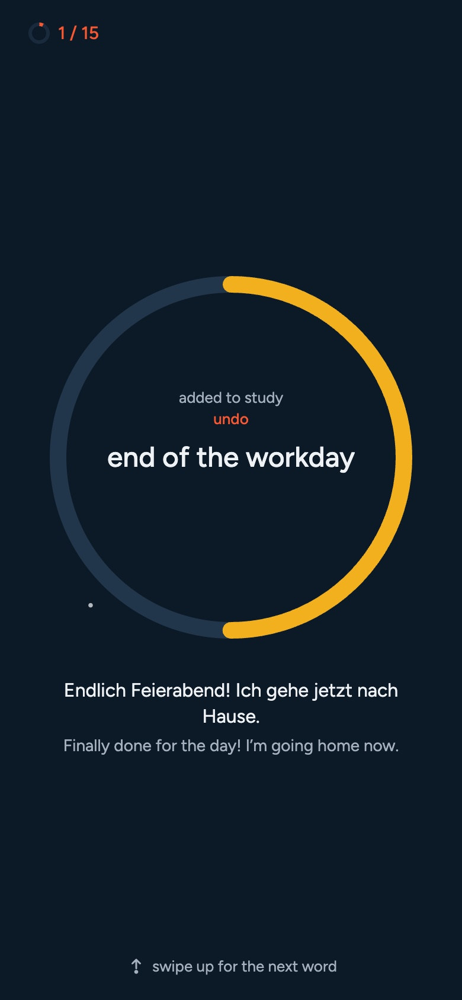 after rating: translation, example | 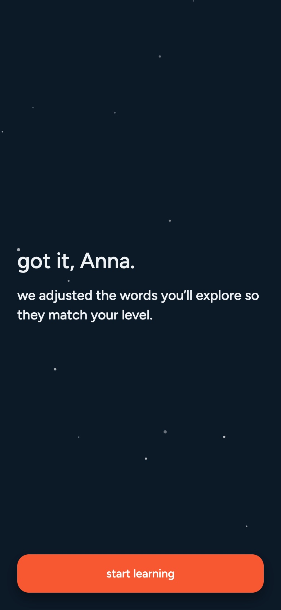 "got it" after 15 words | 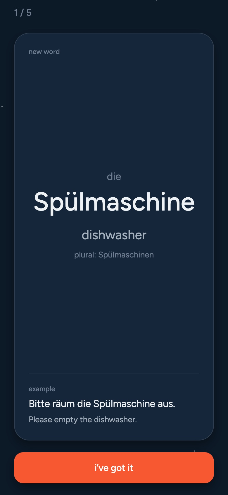 Study: a new word | 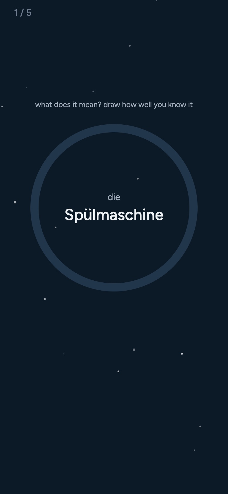 Study: the test |
| 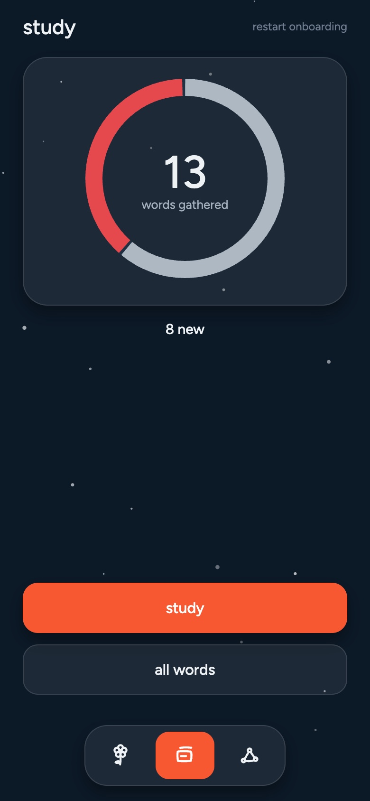 Study home | 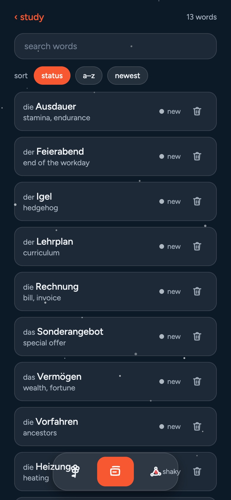 all words | 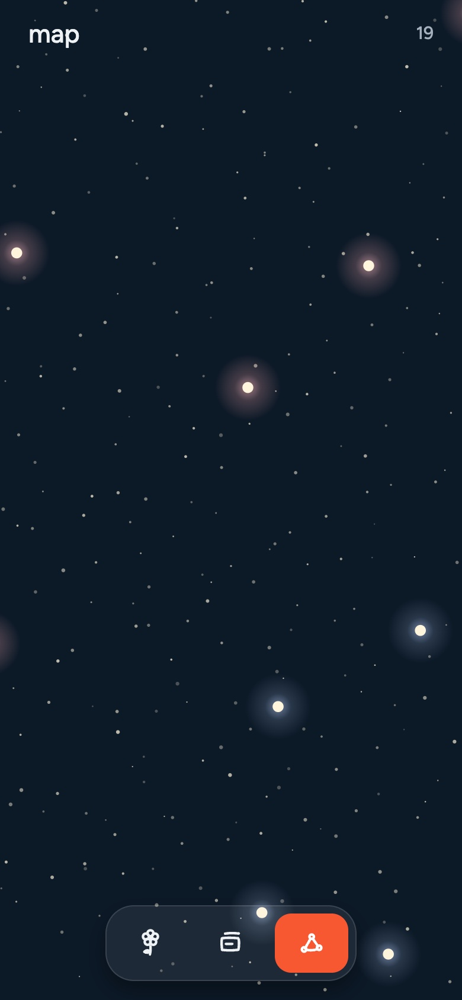 the first Map | 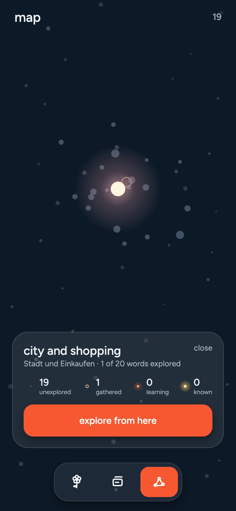 a topic card |

### Iteration 3: the map and the stardust circle (30 Sep, commits `c5e65b3` to `5529305`)

- **Her brief:** "remove everything unnecessary and finish the star map; then the circle, because I want it to be the
  main feature of the app, so let's brainstorm an animation for filling the circle". She also asked that an untouched
  topic's star is visible but not lit, and glows brighter and bigger as you learn its words.
- **Map, rebuilt with shaders** (a friend had pointed her at shader-based UI): stars and word points are drawn by a
  **Skia shader** that twinkles; topics are joined by **threads**; opening a topic shows **a slowly turning sphere of
  dots, one per word**, the ones in study glowing; **every user gets a sky of their own**; pinch to the whole sky with a
  snap; **tilt parallax** from the gyroscope; **camera mode** (turn the phone like a camera to look around the sky);
  a star is dark under 1% of its words taken, a warm point to 10%, then it glows.
- **The circle, rebuilt as stardust.** She tried several looks side by side in a lab screen on her phone: red-to-green
  arc, comet, liquid, a star trail, a line trail. **What stayed:** no visible ring at all; stars appear where the finger
  goes; **the colour never changes, the rating shows as how much the stars shine** (a few small blue stars for "don't
  know", a golden blaze for "know"); let go early and the ring finishes itself.
  **What she rejected for good:** red-to-green, fireworks, a pale light fill that hid the word, comet and liquid looks.
- **Study in two parts:** new-word cards first, then every word in the circle. Explore and Study hand the user over to
  each other automatically.
- **Small but telling:** the Explore tab icon became a telescope; long-pressing a title became a hidden menu (used for
  the lab and later for "start over").
- **Learned:** the app now had a point of view (night sky, stardust). Time to put it in front of other people.

### Iteration 4: two usability tests, two reworks (10 Oct, commits `1e3b2d2` to `f361926`)

She ran **two usability tests with friends** and brought the findings to the chat. Round one (fixes):

- People **could not find the invisible ring** -> a drawing may now start anywhere round the word, and a tip sits above
  the circle.
- The "swipe up" tip was too small and vanished -> larger, for the first three words; swipe up added to the Study test.
- A Study session needed enough words waiting (three) and the tab did not refresh when opened -> fixed.
- The example's English translation was missing in the Study test; theme stars were too small on the Map.
- She added a hidden "start over" so she could reset the app between friends.

Round two (rework of the **first minutes**):

- **A new first run:** name, one intro screen, then a **practice screen on one word, with no test**, a quick-test screen
  ("here is a quick test to adjust new words to your level") and the 15 words, then the tabs open on Study.
- **Study became a list plus a test:** a list of the words you are learning, a "study" button, and a test that looks
  exactly like Explore; it ends with "nicely done".
- **The "known word" moment was not understood:** nobody noticed that a star lit up. It was replaced by **stardust that
  drifts up and out of the top of the screen** while the ring glows, then settles to a golden ring.
- **The Map became meaningful:** topics are placed by a **hand-made list of neighbours in meaning**, the same layout
  for everyone, with the easy topics at the top left and the hard ones at the bottom right. A first-visit card explains
  the Map. The list of words moved from the Map into Study.
- **Study sizes:** "quick study" (10 words) and "study all" (up to 50); deleting a word asks first.
- **Release setup started:** a bundle id, an EAS project (the build service).
- **Learned:** the structure was now right; what was missing was real content, and a way for the app to leave the
  laptop.

### Iteration 5: real words, real structure (14 Oct, commits `1740545` to `f78c0e7`)

- **500 words became 1,474,** built by a **pipeline on real data**: a frequency list of German (tiers now come from
  data, not from eyeballing), article, plural and meaning from Wiktionary, example sentences from Tatoeba, topics chosen
  by hand. The raw data stays out of git. This forced a **credits screen** (CC BY-SA and CC BY 2.0 FR sources).
- **Profile and settings:** an avatar (later a fourth tab) opens the name, three numbers, **a daily reminder** (a local
  notification set when the app goes to the background and only when words are ready), quick sessions, start over.
- **Study as she had imagined it:** a list with sort and search icons on the title row, one "study" button (a
  quick-session switch in settings), word cards you swipe up and down.
- **Explore grew modes:** "by association", "by theme in kitchen", "by usefulness"; filters for level and kind of word;
  interests that the feed prefers. The word on screen follows a change of mode.
- **A UI rule is written down:** `COMPONENTS.md` lists every component and the rules (going back is a chevron, nothing
  pops, one title style); `CLAUDE.md` tells the next Claude to read it first. This is the point where the design started
  to be **governed**, not just made.
- **Learned:** it was ready for people outside the room.

### Iteration 6: out the door (14-17 Oct, commit `063ce07` and `3900179`)

- **How to release under someone else's account:** a friend with a personal Apple Developer account invited her as **App
  Manager**; the app was created in App Store Connect, an **API key** let the build service submit without anyone
  logging in, and the **bundle id** was fixed. Certificates and signing are handled by EAS.
- **The icon:** designed in an image tool from a written brief: a falling star on dark blue first, then **a four-pointed
  star in the middle of a ring of tiny stars** (the ring is the circle, the stars are the map). Kept as an SVG next to
  the PNG, enlarged so the star still reads at home-screen size.
- **TestFlight:** five builds in total; an internal group, then an external group with a **public link** (which needs a
  short Apple review). Texts for testers were written.
- **Learned:** using it daily on her phone produced the next list.

### Iteration 7: the design-polish round (17-19 Oct, commits `4d8df4e` and `3c51484`)

She sent **a list of 16 changes**, then more, one by one, with screenshots. Highlights (the details are in `SPEC.md`):

- **First run, redesigned:** a welcome screen with a **falling star drawn for it** ("learning words can be the most boring
  part of learning a language. but with easy quizy it turns into an explorative journey"), the name, then
  **interests chosen up front** ("welcome, name"), "here is how easy quizy works", the practice word, and a **progress
  bar** across the top. Interests left the settings.
- **A cross for "I don't know this word at all"**, inside the circle under the word, so you do not have to draw
  nothing; the ring then draws itself in dark blue. It vanishes the moment you start drawing.
- **Status as a circle**, the app's own metaphor, instead of the word "new" plus a dot; before the first study, a word's
  circle follows how you rated it (a question she asked: "I know some better than others, should that count?").
- **Study cards got useful:** words it often comes with, how common it is, extra examples (computed from the sentence
  data); **add your own words** with a check against our list while typing and a part of speech.
- **The Map:** open a topic and tap the sphere (or pinch in) to go **one level further in**, to a page with its words,
  explored ones first, instead of a cramped bottom card; **labels never overlap** (she said "never", so a test checks it
  on 160 generated skies); stars kept apart; threads only between topics you have explored; every untouched star is
  identical; five small hand-written topics **merged into the big ones** (24 topics); the Map now sits on the same
  starry paper as every other screen.
- **Explore's controls** went from a filter icon plus a compass, to selects: "by association" (the default), "in
  travel" (only by theme), "my level", "all words". The path there: orange select -> icon -> glass pills.
- **Language fixes from a learner's eye:** reflexive verbs always with "sich" ("ernähren" -> "sich ernähren"; 20 verbs),
  with example sentences that really use the reflexive form. She spotted it on screen.
- **Rules that tightened:** one undo plate in one place on every screen (and undo added to the Study test); a layout
  rule for balanced spacing; "make labels clearer"; "keep it default" (no colour change on a filter).
- **Process note:** every one of these was checked in the iOS Simulator before being reported, and written into the spec
  and the components list in the same step.

---

## 3. Patterns across the iterations (good raw material for the case study)

1. **One gesture, many treatments.** The interaction (draw a circle, four hidden segments, a cross for zero) did not
   change after iteration 1. What changed was how it *looks* (arc -> stardust) and how it *feels* (haptics, snap, unwind
   on undo). The design effort went into making a gesture feel owned.
2. **Metaphor consistency.** Stars everywhere: the rating shines, the background fills with a star per word, a topic
   is a star, a status is a small ring, the icon is a star in a ring. Each new idea was tested against "is this still the
   sky?" (and rejected when not: a dashboard donut, fireworks, red-to-green).
3. **Real people changed the first minutes.** Two friends were enough to rebuild the first run, the "known" moment and
   the structure of Study. The invisible ring was invisible to everyone.
4. **From making to governing.** After four weeks the design needed rules (`COMPONENTS.md`), tests for things she said
   must never happen (overlapping labels, stars too close), and one place for each behaviour (the undo plate).
5. **Designer-led, with an AI doing the building.** She wrote the product, the interaction and the taste calls; the
   tool wrote the code, ran the checks and kept the documents current. Her corrections were frequently about spacing,
   consistency and what a screen *says*, which is the part a designer is for.

## 4. Getting screenshots for the other iterations

Only iteration 2 has screenshots (from an earlier "walkthrough" page the author made on 30 Sep; its Russian captions
are not copied here). Every iteration is a git commit, so the rest can be **captured from the code**:

| Iteration | Commit to check out | Screens worth capturing |
|---|---|---|
| 1 | `c690ccf` | Explore: first word, arc being drawn (red to green), reveal, similar-word chips; the placeholder tabs |
| 3 | `c5e65b3` (Map), `2396b8e` (stardust circle) | Map whole sky and an opened sphere; stardust circle at 20 / 50 / 100%; the telescope tab icon |
| 4 | `f361926` | practice screen, quick-test screen, Study list, Study test, the known-word stardust, the meaningful Map |
| 5 | `f78c0e7` | Explore header with its selects, profile, credits, Study list and card, reminder card |
| 6 | `3900179` | the app icon on the home screen; TestFlight page |
| 7 | `3c51484` (today) | welcome, interests, practice with the cross, Explore selects, Study card, add a word, Map topic page, undo plate |

Method: `git worktree add ../snap-<n> <commit>`, link `node_modules` from the main folder, run Metro on its own port,
open it in the simulator and take screenshots at a fixed device size (iPhone 17 Pro). Early commits only need the
libraries that are already installed. It takes roughly 10-15 minutes per iteration. Ask Claude to do it, one iteration
at a time.

## 5. What is not recorded (and can be added by the author)

- Her own sketches, Figma frames or references from before 19 Sep (none were in the project).
- The actual words of the two testers (only the changes that came out of them are recorded).
- Photos of the app on a real phone and the TestFlight invitation screen.
- Anything about the build and release steps that happened only in a conversation.
